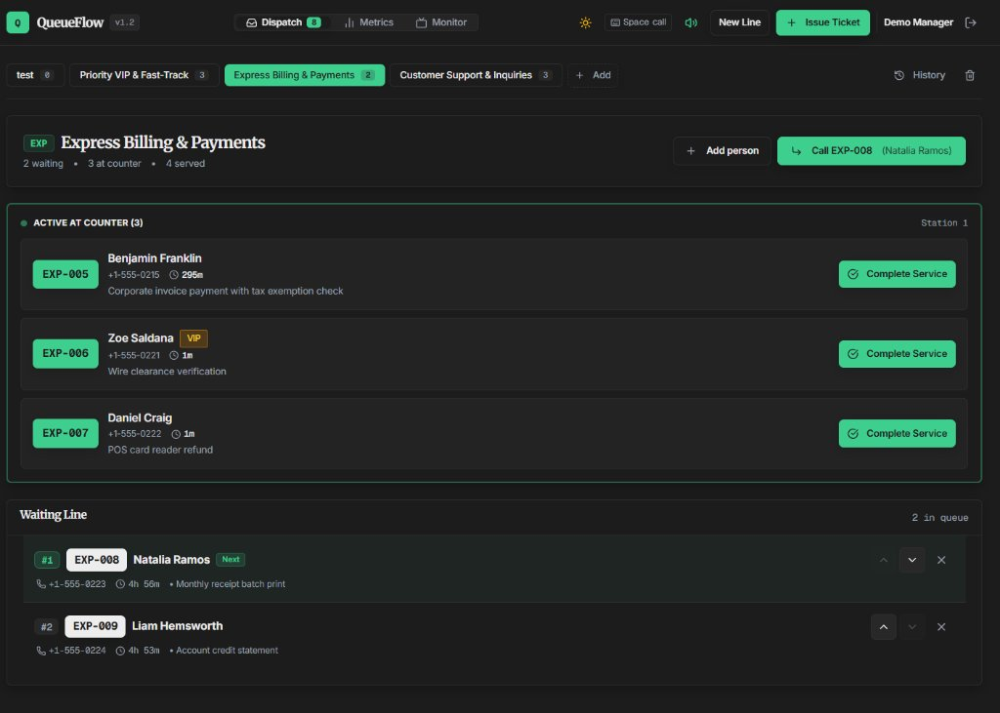
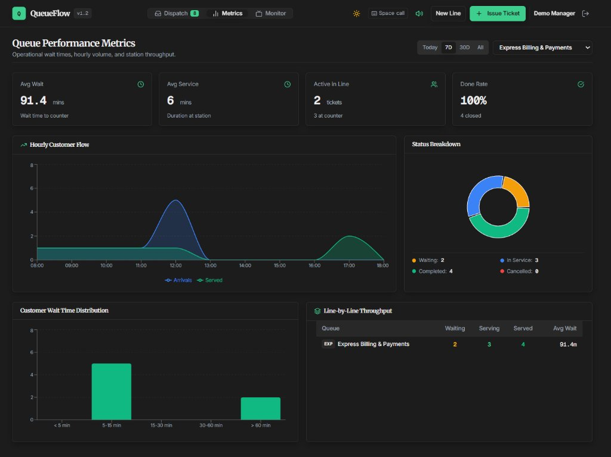
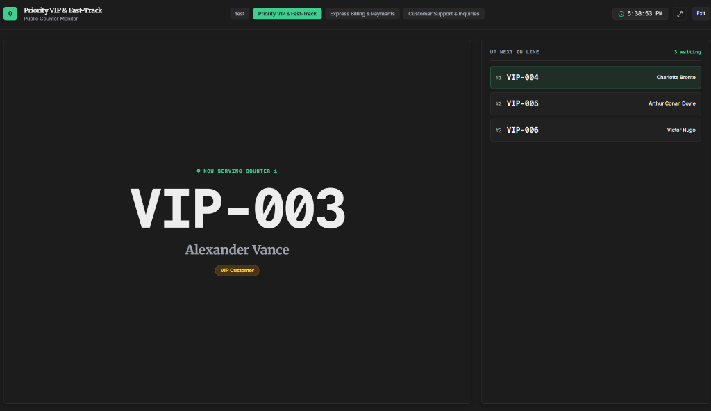

# QueueFlow

QueueFlow is a full-stack, real-time queue management and operational telemetry system built with Express.js, TypeScript, React, and PostgreSQL via Prisma ORM.

## System Overview

### Queue Dispatch Terminal


Operator dashboard for managing active service counters and waiting lines:
- Multi-queue tab navigation with live token counters.
- Active counter management with direct service completion.
- Priority-ordered waiting line with real-time positional reordering and next-in-line ticket dispatch.

### Performance Metrics


Operational analytics dashboard for monitoring throughput and service efficiency:
- Core KPIs: average wait time, average service duration, active queue size, and completion rate.
- Hourly customer flow tracking arrivals against completed services.
- Token status distribution and wait-time duration histogram.
- Scoped date range filtering (Today, 7D, 30D, All) and line-by-line throughput breakdowns.

### Public Monitor Display


Full-screen kiosk view designed for customer-facing waiting areas:
- Prominent callout of the ticket and customer currently being served at the counter.
- Upcoming queue roster displaying next tokens in line.
- Text-to-speech audio chime notifications on customer calls and live synchronized clock.

## Tech Stack

- **Backend**: Node.js, Express.js, TypeScript, Prisma ORM, PostgreSQL (Neon Lakebase), Zod, JWT, bcryptjs.
- **Frontend**: React 19, TypeScript, Vite, Tailwind CSS, Lucide Icons, Recharts.
- **State & Routing**: In-memory queue caching with URL search parameter state synchronization.

## Getting Started

### Prerequisites
- Node.js 18+
- PostgreSQL database instance

### Backend Setup
```bash
cd server
npm install
npm run dev
```
Backend runs at `http://localhost:5000`.

### Frontend Setup
```bash
cd client
npm install
npm run dev
```
Frontend runs at `http://127.0.0.1:3000`.

### Demo Credentials
- **Email**: manager@queueflow.com
- **Password**: password123
